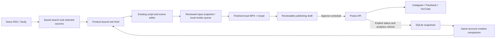

# Reel Factory: repository comparison and implemented upgrade

Reviewed on 11 October 2026. Priorities: Instagram, Facebook, and YouTube;
research → reel creation → scheduling → measured results → next creative test.

## What changed

Reel Factory now has a **Growth** workspace at `/growth`. It connects recent
news and optional web research to source-backed briefs, the existing bilingual
editor, reviewed publishing drafts, Postiz scheduling, delivery synchronization,
per-post analytics, CSV export, and suggestions for the next creative test.

The follow-up Wan2GP review added a durable local render queue, input snapshots,
stage reporting, explicit retries and repeat renders, and portable render presets.

This is an end-to-end workflow addition, not complete feature parity with seven
projects. No comparative output-quality or engagement benchmark was performed;
there is no evidence to claim Reel Factory is now objectively “the best.”

## Exact repositories inspected

All seven were shallow-cloned into `../.repo-research/`, outside Reel Factory's
repository. The copies preserve their upstream licenses. No upstream source
files were incorporated into Reel Factory; the integration and workflow code
are new implementations. The public API shapes informed the Postiz adapter.

| Repository | Inspected commit | License in checkout | Useful code inspected |
| --- | --- | --- | --- |
| [BrightBean Studio](https://github.com/brightbeanxyz/brightbean-studio) | `89a5d7dbdd3e47865549d9c0ebf9c7114a538f8f` | AGPL-3.0 | `apps/api/routers/posts.py`, `apps/api/routers/media.py`, `apps/api/schemas.py`, `apps/analytics/derive.py` |
| [BrightBean Studio Agent](https://github.com/brightbeanxyz/brightbean-studio-agent) | `7ee2bd1133720fec67ae92a3a28854ef8390b279` | MIT | `reference/rest-api.md`, `reference/analytics.md`, `reference/rate-limits.md`, API examples and schema |
| [Postiz](https://github.com/gitroomhq/postiz-app) | `91c91f633a0175fb3914dba64c932928c514b72a` | AGPL-3.0 | `apps/backend/src/public-api/routes/v1/public.integrations.controller.ts`, post DTOs, Instagram/Facebook/YouTube settings and provider analytics, posts service/repository |
| [LangChain Social Media Agent](https://github.com/langchain-ai/social-media-agent) | `fd94d602a190333d8fb4a5619b11ff2c5330fa8b` | MIT | `src/agents/generate-post/generate-post-graph.ts`, human-review node, curation loaders, report and rewrite flow |
| [MoneyPrinterTurbo](https://github.com/harry0703/MoneyPrinterTurbo) | `4204d0f39afa8ada6f3edc31604141f959fe254e` | MIT | `app/services/task.py`, generation stages and cross-post state/recovery, service/controller structure |
| [Short Video Maker](https://github.com/gyoridavid/short-video-maker) | `9bb9a212ced86caa7e09099c382da1a44d638760` | MIT | `src/short-creator/ShortCreator.ts`, REST and MCP routers, Kokoro/Whisper/Remotion integration structure |
| [Wan2GP](https://github.com/deepbeepmeep/Wan2GP) | `6479db36bdc2619a904a852bba9c2d78e1a83f82` | WanGP Community License 2.0 (`LICENSE.txt`) | `shared/api.py`, `shared/settings_metadata.py`, `shared/utils/settings_bundle.py`, `docs/API.md`, `docs/CLI.md` |

These were targeted code reviews, not full security audits or live executions
of the reference applications. License entries describe the checked-in files;
they are not a recommendation to merge differently licensed projects wholesale.

## Findings that shaped the implementation

**BrightBean Studio** separates drafts, schedules, platform delivery, and
analytics snapshots. Its API has account scoping and idempotency keys; its
analytics code treats freshness and metric denominators explicitly. Reel Factory
now distinguishes accepted schedules from confirmed publication and stores dated
analytics snapshots. Missing metrics remain unavailable rather than becoming zero.

**BrightBean Studio Agent** is an API/agent package, not an additional video
renderer. Its request contracts, permission rules, and rate-limit documentation
are useful integration references. It is not installed as an agent skill here.

**Postiz** supplies the broad publishing layer. Its public API exposes connected
accounts, multipart uploads, scheduled posts, post lists, and post analytics.
Reel Factory uses those endpoints for the three requested platforms. Platform
settings are explicit: Instagram/Facebook post type, and YouTube title, visibility,
and child-audience declaration. Postiz's own service remains responsible for
OAuth, token refresh, platform publishing, and running future schedules.

**LangChain Social Media Agent** links source processing and generation to human
review and scheduling. Reel Factory adopts the workflow idea: select sources,
write an angle, review the generated reel, and approve a publishing draft.
Research text is passed as untrusted reference material, not operational commands.

**MoneyPrinterTurbo** has a broader topic-to-video pipeline, multiple media and
voice providers, and separate cross-post handling with interrupted-task recovery.
The inspected version already contains cross-posting code; calling it only a
renderer would be inaccurate. Reel Factory now persists intermediate publishing
states before network calls. The new render queue uses the same durable-job
principle independently of publishing.

**Short Video Maker** exposes a scene-based video service over REST and MCP and
combines local voice, transcription, stock footage, and rendering. Its inspected
queue is in memory and contains mutex/semaphore TODOs. That queue should not be
copied as the durability model for Reel Factory. Local speech and word-timed
captions remain useful separate extensions.

**Wan2GP** provides settings export, saved queues with media attachments,
headless processing, job progress and model capability discovery. Its Python
API is in-process; it is not a standard REST generation endpoint. Reel Factory
adopts the settings/queue workflow through new code: validated JSON presets,
reviewed script and media snapshots, persistent state and progress, explicit
retries, repeat renders and recipe sidecars. The checked-out upstream uses its
own community license; no source or model weights were incorporated here.
Local prompt/image-to-video, GPU profiles, model downloads and MCP integration
remain separate potential additions.

## Feature coverage after this change

“Implemented” means code exists with the validation described below. External
services still require working accounts, credentials, and platform permissions.

| Capability | Reel Factory status | Evidence or remaining work |
| --- | --- | --- |
| Hindi/English scripts, narration and captions | Existing | Script/TTS modules and regression suite |
| Product facts, branding, calls to action | Existing | Product/brand editor and generation prompts |
| Mixed photo/video scenes and collections | Existing | Scene editor, collection workflow, FFmpeg renderer |
| Preview, scene editing, saved scripts | Existing | Browser editor and preview tests |
| Multiple shapes, templates, music, hook variants | Existing | Build workflow and render tests |
| Recent news discovery | Implemented | Free Google News RSS search; dates, source links, saved results |
| General web research | Implemented adapter | Tavily search; key required; mocked contract tests |
| Research-to-script handoff | Implemented | Saved brief attached to product, source selection, generation/rewrite/build integration |
| Live social trend/sound rankings | Missing | News search is not social popularity measurement; needs a suitable data provider |
| Instagram/Facebook/YouTube publishing | Implemented via Postiz | Multipart upload and platform-specific scheduled posts; live connection required |
| Review before publishing | Implemented | Save/edit local draft, review video/caption/time, explicit schedule action |
| Time-zone handling | Implemented with fixed offsets | Explicit offset, India default `+05:30`, UTC storage; automatic DST zones are not implemented |
| Remote schedule operation while PC is off | Delegated to Postiz | Requires running Postiz hosted/self-hosted service |
| Delivery status and published links | Implemented | Explicit refresh, provider state mapping, remote ID persistence |
| Concurrent/double submission of one draft | Protected | Atomic SQLite claim; four-way concurrency test |
| Uncertain network writes | Protected | No automatic resubmission; manual reconciliation using existing Postiz ID |
| Cancellation | Implemented for queued posts | Checks remote state before requesting removal; no public-post deletion workflow |
| Per-post analytics | Implemented via Postiz | Latest provider datapoints, fetch dates, unavailable states and stored snapshots |
| Results export | Implemented | Latest metrics CSV, spreadsheet formula neutralization |
| Creative feedback loop | Implemented, descriptive | Same-account view-count comparison → suggested experiment → new brief |
| Best-time prediction or causal attribution | Missing | Needs enough comparable dated observations; current comparisons do not prove causation |
| Conversion, sales and enquiry attribution | Missing | Needs tagged links, CRM/order data and attribution design |
| Native direct Meta/YouTube OAuth inside Reel Factory | Missing | Account management currently happens in Postiz |
| Legacy CLI direct social publishers | Still placeholders | New live bridge is in Growth; old calendar folder/dry-run paths are unchanged |
| Multi-account batch campaign fan-out | Partial | Save one draft per connected account; no combined bulk action |
| Automatic analytics polling/webhooks | Missing | Refresh is explicit; snapshots persist locally |
| Durable background video render queue | Implemented locally | SQLite state, serial worker, OS lock, stage/count updates, waiting cancellation, stop after current video and explicit retry; server must stay running |
| Render presets and saved input recipes | Implemented | Validated JSON import/export, product/media/brand/template snapshots, per-video recipe sidecars and repeat renders |
| Topic-to-stock-video assembly | Partial | Research and script direction added; stock-photo search and uploaded clips already exist; automatic footage assembly remains |
| Fully local neural speech and Whisper word alignment | Missing | Existing voice providers remain; silent local rendering is available |
| AI video/avatar generation | Missing | Requires a separate provider integration and quality checks |
| REST/MCP rendering service | Missing | Existing CLI and browser routes are not a general authenticated agent API |
| Teams, roles, client approvals and shared inbox | Missing locally | Some are available in the external schedulers; no equivalent local multi-user system |

## Architecture and operational behavior

Local state is in `growth/workspace.sqlite3` beside `brand.yaml`, excluded from
Git. API keys stay in the existing API settings `.env` location. The Postiz
server URL used for a submission is retained to prevent syncing that post
against a different configured server by accident.

Submission states are `draft → uploading → submitting → scheduled`. Only a
remote `PUBLISHED` result marks a post `published`. Upload failures can be
retried because no schedule call has started. Ambiguous schedule responses
become `uncertain`; a crash during the call leaves `submitting`. Neither is
automatically retried. A separate newly created draft is still a separate
publishing action: the app does not globally deduplicate all similar content.

The adapter does not claim provider-side exactly-once delivery. It records
intent before the remote write and favors a visible reconciliation step when
the remote outcome is unknown.

## Setup and first real-account check

1. Run `python -m reelfactory serve` and open **Growth**.
2. Use free news search, or configure **API settings → Tavily** for web search.
3. Select sources, write a reel angle, choose a product, and save the brief.
4. In the editor, select an AI writer to use the brief, review the script,
   render, and use **Schedule this reel** beside the finished video.
5. Connect the requested social accounts in Postiz. Enter its API key under
   **API settings → Postiz**. The default public API root is
   `https://api.postiz.com/public/v1`; a self-hosted deployment needs its own
   complete public API root.
6. Refresh connected accounts, select the MP4/account, review title/caption,
   set the time and offset, and save a draft. YouTube defaults to private.
7. Review the draft and choose **Approve & schedule** when ready to publish.
8. After delivery, use **Refresh status & analytics** and inspect the actual
   published link. Provider analytics may be unavailable or delayed.

No live social post was submitted during implementation. Platform acceptance,
token refresh, actual delivery, and analytics availability must still be
verified with the user's connected accounts. Tavily's paid/keyed endpoint was
contract-tested with fixtures; no live Tavily request was made.

If you move a scheduled post more than two days in Postiz, Reel Factory's
current reconciliation search will not find it. Restore its original date
temporarily to sync, or manage it directly in Postiz. Cancelled/removed remote
posts may require checking the Postiz calendar directly after an uncertain
cancellation; absence is not automatically treated as proof of cancellation.

## Validation

- Baseline before modifications: 481 fast tests passed, 17 render tests excluded.
- New isolated tests in `tests/test_growth.py` and `tests/test_web_growth.py`: 44 passed, covering workflow
  state, concurrency, unsafe paths, credentials, API contracts, source provenance,
  timestamp conversion, editing, cancellation, CSV export, and script/build handoff.
- Regression run with the first 38 new tests: 519 passed, 17 render tests excluded.
- Live unauthenticated news search returned eight results, all with publication dates.
- Full suite before the final concurrent-edit safeguard: 541 passed, including
  all 17 real-render tests, in 248.36 seconds. The added safeguard passed the
  final 44-test focused workflow run.
- Final fast regression run after that safeguard and test-file split:
  525 passed, 17 render tests deselected, in 90.02 seconds. No rendering code
  changed after the full-suite run. Compilation and Git whitespace checks passed.
- Chromium desktop/mobile checks exercised source selection, brief handoff,
  draft editing, scheduling and analytics (publishing provider mocked).
  There were no JavaScript errors or mobile horizontal overflow. Synthetic-data
  screenshots and results are in `out/growth-review/` (not committed).
- See the final validation section in `FEATURE_CHECKLIST.md` for the final suite result.

### Wan2GP follow-up validation

- The initial render-queue implementation passed the fast regression suite
  (545 tests). Four additional cases cover variant selection, jobs arriving
  during rendering, secret-free brand asset snapshots and repeat renders.
- Final focused queue/preset checks: **24 passed**, with the real-video case
  run in the separate slow suite. Cases include concurrent-worker exclusion,
  restart recovery, partial output retention, explicit retry and validated imports.
- All **18 real-render tests passed** in 160.47 seconds, including the new
  saved-input background render with FFprobe validation and recipe output.
- Chromium checks exercised preset save/apply/import/export without losing
  script edits, a real queued silent render, repeat rendering, output-to-Growth
  links and desktop/mobile layouts. No JavaScript errors or horizontal overflow.
  Synthetic screenshots and results are in `out/render-review/` (not committed).
- Compilation and Git whitespace checks passed. No AI model downloads or live
  social posts were used for this follow-up.

## Next implementation priorities

1. Verify real account publishing and analytics, then add automatic refresh,
   remote rescheduling, broader reconciliation, and bulk account selection.
2. Extend the local render queue with a standalone worker service, per-stage
   resume and a control that interrupts FFmpeg or voice work immediately;
   waiting cancellation and stopping after the current video are implemented.
   Snapshot retention/cleanup controls remain future work.
3. Add stock-video discovery and scene-aware assembly, local neural speech,
   and forced alignment for reliable word-level subtitles.
4. Add experiment IDs, equal-age comparisons, tagged links, and business-result
   imports before attempting performance optimization or best-time claims.
5. Add authenticated REST/MCP access and, only if needed, teams and approval roles.

API reference checks: [Postiz public API](https://docs.postiz.com/public-api/introduction),
[official Postiz API examples](https://github.com/gitroomhq/postiz-docs/blob/main/SKILL.md),
[Tavily search API](https://docs.tavily.com/documentation/api-reference/endpoint/search).
