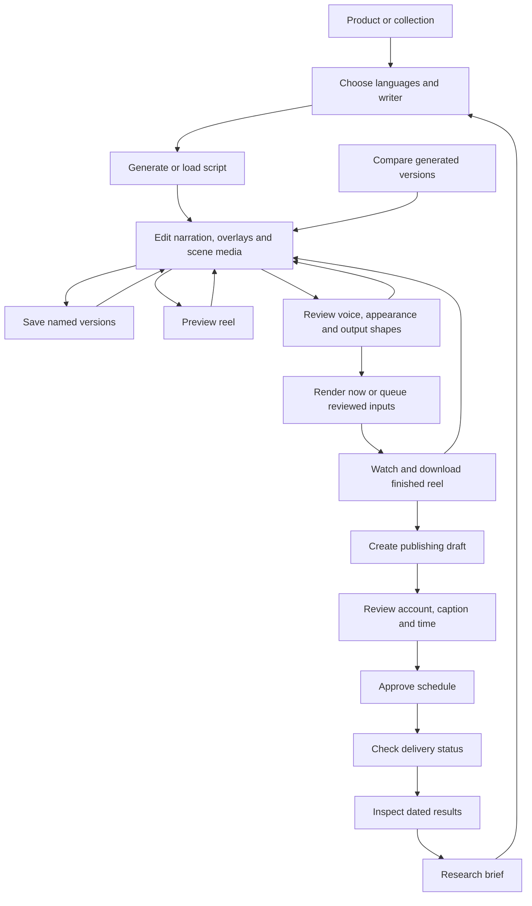

# UI and user-flow comparison

Reviewed 15 October 2026. Research location: `../.repo-research/`.

## Conclusion

Reel Factory should center the creation flow on an editable draft. The recommended sequence is **choose languages → generate or load → edit script and scenes → preview → review render settings → render → review the finished reel → schedule**. Editing, saving, rendering and publishing need distinct actions with visible results.

The strongest combination for this product is BrightBean's draft/save/preview organization, Short Video Maker's scene-first editing, Postiz's separation of draft and schedule states, and Wan2GP's job recovery and reusable settings. Keep Reel Factory's Hindi/English tabs, product facts and local rendering. Its existing light palette, semantic controls and compact three-step form are a suitable foundation.

This is a reasoned recommendation for Reel Factory's users and capabilities, not a measured ranking of the reference apps. Adding more panels or copying a full social-management dashboard would not by itself resolve the reported editing problem.

## Scope and evidence

All seven local checkouts were inspected through their UI source, workflow source or workflow documentation. MoneyPrinterTurbo's bundled English UI screenshot was also inspected. The reference apps were not installed or run; descriptions of their interaction follow the inspected source, rather than a live usability test.

Reel Factory's updated flow was exercised in Chromium at desktop and mobile sizes using disposable products. The renderer was stubbed for the browser checks: they verify the editing and request handoff, not the visual quality of a finished MP4. The inspected reference revisions are the same as the earlier [repository comparison](REPOSITORY_COMPARISON_2026-10-11.md); this review focuses on UI and workflow rather than provider/API coverage.

| Reference | Local revision | What was inspected |
| --- | --- | --- |
| BrightBean Studio | `89a5d7d` | [Composer](../../.repo-research/brightbean-studio/templates/composer/compose.html), [preview panel](../../.repo-research/brightbean-studio/templates/composer/partials/preview_panel.html), draft list and creation landing page |
| BrightBean Studio Agent | `7ee2bd1` | [Workflow documentation](../../.repo-research/brightbean-studio-agent/reference/workflows.md) and README; agent package, not a separate visual application |
| MoneyPrinterTurbo | `4204d0f` | [Web UI](../../.repo-research/MoneyPrinterTurbo/webui/Main.py) and [bundled English screenshot](../../.repo-research/MoneyPrinterTurbo/docs/webui-en.jpg) |
| Postiz | `91c91f6` | [Composer modal](../../.repo-research/postiz-app/apps/frontend/src/components/new-launch/manage.modal.tsx), editor, media uploader, calendar and state filters |
| Short Video Maker | `9bb9a21` | [Creator](../../.repo-research/short-video-maker/src/ui/pages/VideoCreator.tsx), video list/details and layout |
| Social Media Agent | `fd94d60` | [Review node](../../.repo-research/social-media-agent/src/agents/shared/nodes/generate-post/human-node.ts), generation graph and rewrite node; uses an external Agent Inbox for review |
| Wan2GP | `6479db3` | [Gradio application](../../.repo-research/Wan2GP/wgp.py), studio styling and queue/edit controls |

## Reference UI elements and user flows

### BrightBean Studio

The composer makes caption editing the central task. Account pills select destinations, media sits near the content, and platform previews occupy a separate panel. The preview becomes a drawer on smaller screens. Save Draft, autosave status and publishing/scheduling controls distinguish persistence from delivery. A draft list provides a route back into editing. Publication failures appear in the composer; published/publishing content offers cloning instead of an ordinary editable draft.

**Flow:** choose a workspace/destination → compose text and media → inspect platform preview → save draft or set delivery mode → schedule/publish → inspect delivery and analytics.

**Adopt:** obvious save actions, retained draft identity, local errors, preview close to the editor, and distinct draft/schedule status. **Adapt:** use scene narration and overlays as the central editor instead of a single social caption. The enterprise account, approval and sidebar density is unnecessary for the immediate local reel task.

### MoneyPrinterTurbo

The UI groups script, video, audio and subtitles. The script can be generated and then edited in a text area before video generation. Voice preview and advanced controls have explicit affordances. The inspected source also includes stage-oriented task handling and task history; the bundled screenshot illustrates the grouped settings layout, but does not prove the latest code behaves exactly like that screenshot.

**Flow:** enter a subject → generate/edit script and search terms → choose visuals, voice and captions → generate → inspect task/output.

**Adopt:** generated copy remains an input, voice can be checked before a costly render, and settings are grouped by their purpose. **Adapt:** keep the most important decisions visible and collapse technical options; four dense columns are a poor fit for Reel Factory's narrow form and mobile use.

### Postiz

The composer combines a content editor, uploaded media, destination-specific settings and a separate preview. It exposes Save as Draft and scheduling as different operations. Calendar/list filters distinguish scheduled, draft and published entries. Mobile interactions separate editing from preview and move settings into sheets.

**Flow:** choose channels → compose/edit and upload → inspect channel previews → save draft or schedule → filter the calendar/list → reopen the relevant post.

**Adopt:** status filters, platform-specific publishing fields, mobile edit/preview separation and explicit delivery actions. **Adapt:** borrow the workflow, not every implementation detail: inspected mobile controls include clickable `div` elements that should be semantic buttons in Reel Factory.

### Short Video Maker

The creation page starts with numbered scenes. Each scene has editable narration and visual search terms, with add/remove controls. Video settings follow the scenes. Submission goes to a detail page that polls status, plays a ready video and offers download. The inspected detail screen does not expose a direct return to editing those same scene inputs.

**Flow:** write scene text and visual terms → add/remove scenes → configure output → submit → watch processing status → play/download.

**Adopt:** scenes are first-class editable units and always precede the render action. **Improve on it:** preserve the editable input and provide edit/rebuild after completion; do not turn a finished video into a dead end.

### Wan2GP

The UI exposes capability-dependent generation modes and groups advanced controls into tabs. Its queue has save/load controls and a path for editing a queued task. Galleries, presets and job status support repeated work rather than treating every generation as a fresh form.

**Flow:** choose a supported generation mode → configure inputs/settings → submit or queue → monitor → reuse/edit inputs and settings.

**Adopt:** reusable settings, durable job state and clear retry/reuse actions. **Adapt:** hide unavailable capabilities and avoid bringing model/GPU controls into a product reel editor. Reel Factory already has local render snapshots and presets; the next UI improvement is clearer access to the exact input that produced an output.

### Social Media Agent and BrightBean Studio Agent

Social Media Agent generates content, interrupts for human review, accepts edits or rewrite instructions, and then schedules or ends the thread. Unknown responses return to review. BrightBean Studio Agent documents a create-draft → edit → schedule lifecycle, along with direct scheduling when explicitly requested.

These are workflow references, not complete visual design systems. **Adopt:** generation produces reviewable content; rejection/revision returns to that content; saving a draft and authorizing delivery are separate transitions. Their service setup, permissions and agent-specific interface do not belong in Reel Factory's ordinary creation screens.

## Comparison with Reel Factory

“Before” describes the flow inspected when the editing issue was reported. “Updated” includes the script fixes completed during this review. Other entries remain recommendations.

| Area | Reel Factory finding | Reference lesson | Decision |
| --- | --- | --- | --- |
| Starting a reel | Product cards, collections and research briefs already lead into the editor | Choose a clear object and next action | Retain these entry points; eventually show draft/last-render status on product cards |
| Generated script | Before: edit fields existed below a large rendered-preview section | BrightBean and Short Video Maker make editing the primary surface | **Updated:** editable lines precede the optional preview; direct save/rewrite shortcuts are visible |
| Multiple versions | Before: selecting several versions produced read-only summaries | Each selected creative should remain a revisable draft | **Updated:** every selected version has editable text, media and scene controls |
| Saving versions | Named single scripts existed; multi-version editing needed equivalent persistence | Save is separate from rendering and should be discoverable | **Updated:** selected versions save separately and stay in the editor; individual saved versions can be loaded later |
| Changing selections | Before: the multi-summary told users to go back without restoring a picker | Return paths must preserve the current work | **Updated:** Change selected versions returns the current selected drafts to the picker with edits retained |
| Adding a language | Selecting another language could lead to unreviewed generation during a build | Review the generated content before the expensive action | **Updated:** build requires drafts for all selected languages; missing-language generation keeps existing edited drafts |
| Preview | Rendered previews, stale-preview detection and scene seeking already exist | Keep a visible edit/preview loop | Retain; a side preview on large screens and explicit Edit/Preview tabs on phones are a later layout improvement |
| Voice and appearance | Review contains voice, music, output shape and advanced appearance | Group by purpose and show only applicable controls | Retain provider-dependent voice controls; add a short voice-only sample later |
| Render recovery | Queue, snapshots, retry, partial outputs and recipes already exist | Wan2GP makes repeated jobs manageable | Retain; add queue filters and a reopen-exact-inputs action rather than relying on Open product |
| Publishing | Growth saves local drafts before Approve & schedule | Postiz/BrightBean distinguish draft, schedule and publication | Retain explicit approval and delivery status; show account-specific fields only for the chosen platform |
| Results | Growth has dated metrics and a route from insights to a new brief | Results should create the next actionable experiment | Retain; make filters and freshness easier to scan |
| Navigation | Product flow uses steps; Growth stacks research, publishing and results on one page | Larger apps separate tasks while retaining context | Keep the creation wizard; later split Growth into focused Research, Drafts/Schedule and Results views |
| Draft recovery | Named saves exist, but creation drafts and settings are not automatically restored after leaving | BrightBean exposes autosave state and reopens drafts | Next major priority: persist a working reel draft, distinguish autosaved work from named versions, and offer recovery |

The new selection-return action contains the versions selected for editing. It does not retain discarded alternatives after the original comparison was confirmed. Reloading a named script restores that script; it is not yet a saved multi-version project with all render settings.

## Recommended complete flow

Saving and rendering must preserve the same text/media pairing. Rewriting is an explicit operation; changing voice, output shape or quality should not silently generate new words. Failed operations should return to the relevant draft with an actionable error. Scheduling must remain a separate decision after the finished reel exists.

## Design skill and remaining UI findings

Applied the official [Vercel Web Design Guidelines skill](https://github.com/vercel-labs/agent-skills/blob/main/skills/web-design-guidelines/SKILL.md) and fetched its [current review rules](https://raw.githubusercontent.com/vercel-labs/web-interface-guidelines/main/command.md). Its usability/accessibility scope is a better match for this audit than the [Anthropic frontend-design skill](https://github.com/anthropics/skills/blob/main/skills/frontend-design/SKILL.md), which focuses on visual direction. The skill was read and applied for this task; it was not installed globally.

Findings below use the skill's file/location format. They are remaining work unless marked fixed:

- `reelfactory/web/templates/build.html` — fixed: script editing, saving and returning to version selection now have visible controls.
- `reelfactory/web/static/scene-editor.css:23` — fixed: dialog scroll containment and bottom scroll padding added.
- `reelfactory/web/static/app.js:38` — wizard step is posted in a hidden field, but does not provide a reloadable URL or durable draft recovery.
- `reelfactory/web/static/app.js:117` — selected script tab survives form posts, but is not a deep link.
- `reelfactory/web/static/app.js:69` — explicit smooth scrolling should check the reduced-motion preference as well as the existing CSS rule.
- `reelfactory/web/templates/build.html` — no guard or automatic recovery for unsaved script edits when navigating away. Saving is still explicit.
- `reelfactory/web/templates/product_edit.html:62` — product editing also lacks a navigation guard for unsaved form changes.
- `reelfactory/web/templates/brand_edit.html:105` — identity fields use text inputs, including telephone/contact values; use appropriate input types and autocomplete.
- `reelfactory/web/templates/build.html:227` — Facebook caption is read-only in the script editor; publishing caption editing exists later in Growth. Clarify that boundary or add editable per-language caption drafts.
- `reelfactory/web/templates/growth.html:80` — publishing time uses a manual UTC offset; present the selected time zone more clearly and eventually support named zones.
- `reelfactory/web/templates/growth.html:81` — YouTube-only settings are displayed even when composing for another platform.
- `reelfactory/web/templates/base.html:27` — six navigation items wrap over multiple rows on a phone; group setup/debug links while keeping creation navigation obvious.
- `reelfactory/web/templates/render_jobs.html:30` — Open product goes to the current product's editor, rather than restoring the exact queued script/settings.

Existing strengths worth retaining: semantic buttons and links, native dialogs, keyboard language tabs, a main-content skip link, live status messages, focus styling, reduced-motion CSS, tap/click scene-reordering alternatives and explicit destructive confirmations. The build readiness guard is a deliberate exception to the guideline preference for always-enabled submit controls: the UI explains what draft is missing and blocks a costly unreviewed render.

## Priorities and acceptance criteria

1. **Complete the editing loop — implemented here.** Single and multiple scripts stay editable; text/media changes survive save, reselection and build. Adding a language preserves the old draft. Empty or unreviewed scripts cannot be built through the browser flow.
2. **Persist the working reel draft.** Reload or returning from product editing should restore text, media, version choices and render settings. Show saving/saved/failed states. Keep named versions distinct from the working copy and preserve queued snapshots.
3. **Make preview and save reachable on long drafts.** Add a compact action bar and a responsive editor/preview layout. Keep keyboard focus and mobile safe areas clear; avoid a preview panel that displaces the editor.
4. **Improve render and publishing handoffs.** Restore a job's exact inputs, filter jobs/posts by state, and show only the selected platform's publishing fields. Preserve existing approval and uncertain-delivery handling.
5. **Split Growth by task and improve onboarding.** Explain missing media or unavailable providers next to the relevant action; give Research, Drafts/Schedule and Results distinct views with retained context.

Do not begin with a framework migration, a new palette or a copied sidebar. Draft persistence and reliable return paths offer more value than visual replacement for the reported problem.

## Validation

- Browser runner: [scripts/audit_script_flow.py](../scripts/audit_script_flow.py). Uses disposable media and stubbed rendering; checks text/media saving, missing-language generation, scene edits, version reselection, mobile overflow and the exact input delivered to the renderer.
- Browser artifacts: `out/audit/script-flow/results.json`, `script-desktop.png` and `script-mobile.png`. These are local audit artifacts and excluded from Git.
- Regression tests cover edited versions, save/load round trips, missing-language generation, incomplete-draft rejection and preservation after errors.
- Final regression run: `python -m pytest -m "not slow"` — **556 passed, 18 deselected**, in 107.21 seconds. The slow real-video render cases were excluded; rendering implementation was unchanged.
- Chromium: **8 workflow checks passed**, no JavaScript errors, no horizontal overflow at 1440px desktop or 390px mobile width. The completed multi-version build also returns directly to editing.
- Corrected one pre-existing regression expectation: running jobs now request stopping after the current video, so the test checks that the job remains active and duplicate stop requests are rejected. Queue implementation was unchanged.
- Python compilation, scene-editor JavaScript syntax and Git whitespace checks passed.
